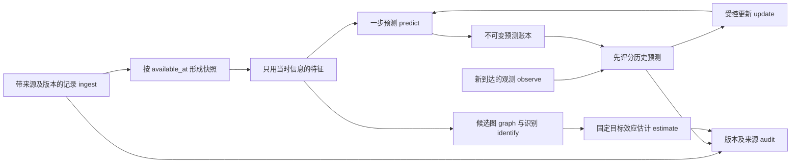

# 因果算法研究：v1 研究计划

版本：v1；检索日期：2026-11-12。本文规定研究问题、识别条件、实验和验收协议；不代表已获得真实数据、已完成确认性实验或已部署持续运行服务。文献核验范围见 [references.md](references.md)。

## 1. 项目定义与目标边界

**项目定义。** 建立一个可审计的离散时间研究原型：在每个预测时点，只使用当时已经到达的数据预测下一步结果；当有动作变量和可辩护的识别条件时，另外估计动作的一步因果效应。研究从可控合成数据开始，随后由真实场景和数据条件决定是否继续。

**四类问题必须分别输出。**

- 关联：哪些变量在给定样本中共同变化；相关系数、回归系数和条件独立关系属于这一层。
- 预测：在指定信息集和自然动作机制下，下一步结果的分布或条件均值是什么。
- 因果：若把动作设为另一个值，在明确目标人群、时间窗和假设下，结果分布如何改变。
- 决策：在效应、成本、约束、风险和日志策略均明确后，选择什么动作。识别效应并不自动产生安全的最优策略。

**v1 目标。** 完成数据可用性快照、时间顺序预测、真实反馈评分、固定目标的效应估计及来源审计；检验遗漏混杂、重叠不足、标签延迟与漂移如何使结论失效。提供可复现实验配置和失败状态，而非强制生成一个效应数值。

**v1 边界。** 默认只预测一步，动作可选且取二值，不执行真实干预，不启用探索策略。无动作或无识别依据时，系统退回预测研究。大模型、强化学习、自动执行、长期策略优化、真实数据接入和长期后台进程不属于最小原型承诺。项目为独立的新项目，不复用旧 proprom5 的代码或实验结果。

## 2. 关键假设、已知条件与待补充信息

### 2.1 已确认事实与工作假设

已确认事实：当前目标是研究方法和构建可验证原型；尚无经本研究审查的真实业务数据、真实干预日志或业务损失函数。本文引用的外部资料仅完成有限的一手来源核验，不能视为系统综述。

工作假设，可在场景确定后修订：

- 时间离散；数据可来自单条时间序列，或多个单位组成的面板。单位内存在时间依赖，单位间是否独立需另行确认。
- 在动作发生前形成状态记录 \(C_t\)，其中可以包括已到达的 \(y_t\)、协变量和必要滞后。未到达的 \(y_t\) 必须保留缺失标记，不能从未来补入当时特征。
- 可选动作 \(A_t\in\{0,1\}\)，目标为 \(Y_{t+1}\)。首个版本不把长程累计收益作为主估计量。
- 记录至少具有 `unit_id`、`event_time`、`available_at`、`record_id`、版本和来源。`event_time` 表示事情何时发生，`available_at` 表示研究系统何时能获得这一版本的信息。
- 标签可能延迟、缺失或被纠正；合成环境可以生成真值，但不能代替真实场景的反事实证据。

### 2.2 必须补充的信息

真实场景启动前需补齐：单位及时间粒度；动作的可操作定义和时间戳；结果的量纲、观察窗口及延迟；目标人群和历史动作策略；数据获取及纠错机制；可能的混杂、干扰和同时性；动作成本及禁止动作；可接受误差、风险和决策权限。若动作定义、动作前后次序或目标窗口未定，因果估计不能进入业务验收。

### 2.3 结论状态和工具限制

每份报告使用 `fact`、`working_assumption`、`unverified_claim`、`tool_limitation` 标明论据状态。预测指标好、图结构稳定、平衡诊断通过，都不能证明无未测混杂、一致性或排除限制成立。没有读取到的论文全文、没有运行的实验、没有获得的真实数据，不得写成已验证结果。

## 3. 总体架构与数据流



逻辑接口先于库和实现细节；具体 Python 包及命令以原型实现和项目说明为准。

- `ingest(records)`：验证字段、单位、时间和来源；通过稳定记录键实现幂等。纠错追加新版本，不覆盖已形成的历史快照。
- `availability_snapshot(as_of, event_cutoff)`：仅选择在决策时刻已经可用、且属于允许事件窗口的记录版本；返回快照标识、记录清单和缺失状态。计划中已知的未来日历变量必须显式声明来源，不能与未来测量值混淆。
- `feature(snapshot, spec)`：执行滞后、缺失处理和变换；缩放、筛选、插补、超参数选择均只能在指定训练窗口拟合，保存特征时钟。
- `graph(context, constraints)`：登记领域给出的图及数据支持的候选图，输出边的证据和不确定性；不把搜索得到的 DAG 写成已证实的机制。
- `identify(estimand, graph, assumptions)`：输出识别公式或拒绝原因；明确调整集、支持域、未测混杂风险和目标人群。
- `estimate(frozen_data, identification)`：在固定窗口上估计效应及不确定性，保留所有失败诊断；不让预测更新静默改变因果估计目标。
- `predict(history, mode, model_version)`：输出信息集、预测模式、动作是否已观测、点预测及可用的预测区间；保存发出时间和模型版本。
- `observe(records)`：接收标签及纠错版本，检查标签与预测的单位和结果窗口是否对应。
- `update(eligible_feedback)`：先对旧预测评分，再用允许的已观测反馈更新后续预测模型；漂移触发监测、审查和版本切换。任何候选动作建议策略保持冻结，自动探索关闭。
- `audit(run_id)`：关联数据快照、特征、假设、参数、预测、评分、更新与拒绝原因，支持重放和追责。

**来源硬约束。** `real_observation`、`synthetic_observation`、`model_prediction`、`counterfactual_simulation` 四类不可互换。只有真实观测可以成为真实业务标签；只有独立的合成实验命名空间可把合成观测作为合成标签。模型预测和反事实模拟始终不是已观测标签。来源不明时拒收。原型只能验证调用方声明的来源类型，无法证明数据真实来源；生产接入还需要可信连接器、原始证据、访问控制和来源认证，不能把来源枚举当作防伪保证。

**延迟与纠错。** 发出预测时冻结特征快照；评分使用后来到达的标签，但不回填预测输入。相同记录重放不重复评分或训练。纠错触发带版本的评分重算和更新审计，不抹去原评分。固定宽限期后仍无标签的样本标为右删失或缺失，并报告比例；不能以“只评分已到达样本”假装覆盖整个目标窗口。

## 4. 数学建模与因果识别路径

### 4.1 状态、观测与信息集

用一般结构因果模型区分未完全观察的状态和记录：

\[
S_{t+1}=f_S(S_t,A_t,U^S_{t+1}),\qquad
C_t=g_C(S_t,U^C_t),\qquad
Y_{t+1}=g_Y(S_{t+1},U^Y_{t+1}).
\]

自然动作由 \(A_t=f_A(H_t,U^A_t)\) 产生。函数形式与外生噪声独立性是需要声明的模型假设，不能由符号本身推出。观测过程还包括延迟、缺失和测量误差。潜在状态 \(S_t\)、神经网络隐状态或压缩表示不必然包含充分混杂信息。

给定预测发出时刻 \(d_t\)，合法历史为

\[
H_t=\sigma\{\text{在 }d_t\text{ 前可用、事件时间不晚于 }t\text{ 的合法记录版本}\}.
\]

实际实现只使用有限特征 \(X_t=\phi(H_t)\)。从 \(H_t\) 压缩为 \(X_t\) 后仍满足预测或交换性条件，是额外假设；一个有限滞后回归并不自动代表充分历史。

### 4.2 三种均值不能混淆

自然策略下、动作尚未发生时的预测是

\[
q^{\mathrm{nat}}_t(H_t)=E[Y_{t+1}\mid H_t].
\]

动作确实发生并被观测后，可发出另一种预测

\[
q^{\mathrm{obs}}_t(H_t,a)=E[Y_{t+1}\mid H_t,A_t=a].
\]

干预问题则是

\[
q^{\mathrm{do}}_t(H_t,a)=E[Y_{t+1}(a)\mid H_t]
=E[Y_{t+1}\mid H_t,\operatorname{do}(A_t=a)].
\]

最后一个等号要求潜在结果与所声明 SCM 干预语义一致。观测动作预测可以有用而不具有因果解释。只有满足后述识别条件时，\(q^{\mathrm{obs}}\) 才可用于识别 \(q^{\mathrm{do}}\)。自然预测还依赖自然动作分布：\(q^{\mathrm{nat}}=\sum_a q^{\mathrm{obs}}(H,a)P(A=a\mid H)\)，动作政策改变可能使原自然预测失准。

### 4.3 一步效应的目标及后门识别

预先指定单位集合、时间窗 \(W\)、目标历史分布 \(P_W^*\) 和动作版本，主目标为

\[
\tau_W=E_{H\sim P_W^*}[Y_{t+1}(1)-Y_{t+1}(0)].
\]

这是在指定既往历史分布上的一步 ATE；改变先前策略后，历史分布可能改变，因此不等于新长期策略的总收益。若目标就是某个冻结测试窗口的历史平均，应明确写为该窗口目标，不能外推整个未来人群。

采用动作前调整集 \(X_t\) 的后门路径需要：

1. 一致性：动作定义清楚，观测到 \(A_t=a\) 时 \(Y_{t+1}=Y_{t+1}(a)\)；单位间无干扰，或干扰已进入设计和估计量。
2. 条件交换性：\((Y_{t+1}(0),Y_{t+1}(1))\perp A_t\mid X_t\)。调整集在动作前，能阻断相关后门路径，不含该动作的中介或由碰撞点引入的偏差变量。
3. 正值性：对目标历史支持域，两种动作概率均大于零；估计稳定通常还要求远离 0 和 1。
4. 数据与目标对应：观测、选择、测量和标签到达机制允许识别目标分布；跨时间或单位迁移需要额外可迁移性假设。

条件成立时，令 \(\mu_a(x)=E[Y_{t+1}\mid A_t=a,X_t=x]\)，则

\[
\tau_W=E_{P_W^*}[\mu_1(X)-\mu_0(X)].
\]

不能从目标人群到训练样本无条件迁移该公式。若样本分布不同，必须说明可运输条件及相应重加权或重定义目标。

### 4.4 AIPW 及其成立范围

在已识别、目标样本适当且标签有效的固定评估窗口 \(\mathcal I_W\) 上，\(e(x)=P(A=1\mid X=x)\)，使用仅由先前训练数据拟合的干扰参数，可计算

\[
\widehat\tau_{\mathrm{AIPW}}=
\frac{1}{n_W}\sum_{i\in\mathcal I_W}
\left[
\widehat\mu_1(X_i)-\widehat\mu_0(X_i)
+\frac{A_i\{Y_i-\widehat\mu_1(X_i)\}}{\widehat e(X_i)}
-\frac{(1-A_i)\{Y_i-\widehat\mu_0(X_i)\}}{1-\widehat e(X_i)}
\right].
\]

在识别、支持、可积性及适当采样/依赖条件成立时，倾向模型一致，或两臂结果回归一致，均可使该估计器一致；“双重稳健”不保护未测混杂、错误目标或结构性无支持。若两组模型都错，不能依赖双重稳健。获得根号样本量正态近似和区间还需要更强正则条件，例如适当范数下的误差乘积达到 \(o_p(n^{-1/2})\)，以及针对依赖数据的控制；一致性不等于这些推断条件。

常规 DML 的随机 K 折结论不能直接移植到时间序列。这里采用按时间先训练、后评估；需要滚动多折时只允许过去预测未来，并视依赖长度留出间隔。即使分块，仍需平稳性或局部平稳性、足够衰减的依赖或明确的混合条件等理论依据；任意长记忆、结构突变或很短的轨迹不保证有效。交叉拟合形式本身不能消除相邻样本依赖。

倾向分数截断只能缓和数值方差，不能恢复不存在的动作支持，也可能引入偏差。无支持时返回 `insufficient_support`；若改估重叠人群效应，先重定义并记录目标，不能继续称为原人群 ATE。

### 4.5 纵向扩展与无法识别时的路径

若既往动作影响后续混杂，且后续混杂影响动作和结果，单个普通回归调整全部事后变量通常不能识别长期总效应。纵向扩展需要在每个时间点声明顺序交换性、一致性及策略相关的正值性，并考虑纵向 g 公式、边际结构模型及逆概率权重，或纵向双重稳健方法。例如在合适的变量顺序下：

\[
E[Y_T^{\bar a}]=
\int E[Y_T\mid \bar L_T=\bar l_T,\bar A_{T-1}=\bar a]
\prod_{t=0}^{T}p(l_t\mid \bar l_{t-1},\bar a_{t-1})\,d\bar l_T.
\]

其中 \(L_t\) 在 \(A_t\) 前，\(Y_T\) 在 \(A_{T-1}\) 后；初始项没有既往动作。具体模型必须核对终点、协变量和动作的顺序，不能把一步 AIPW 按时间重复就宣称估计了长期策略效果。

无法成立后门条件时，首选补测混杂、改善记录或设计随机试验。工具变量只有在相关性、独立性和排除限制可信时才是候选；解释为 LATE 往往另需单调性等条件。回归不连续需要阈值分配、阈值附近连续性及无精确操控等依据。部分识别界限也必须列明结果范围和结构假设。若这些条件均无依据，报告不可识别，不用更复杂模型替代缺失的设计。

### 4.6 预测、滚动模拟与决策目标

预测器在过去数据上最小化预先选择的损失，例如连续结果的平方损失
\(\widehat\theta=\arg\min_\theta\sum_{i\in\mathrm{train}}(Y_{i+1}-q_\theta(H_i,A_i))^2\)。若输出完整概率分布，可用对数评分等适当评分规则。预测损失不用于证明调整集充分，也不是因果效应的优化目标。

多步模拟需要显式的转移分布和动作方案：

\[
\widetilde S_{t+k+1}^{(m)}\sim\widehat p(S'\mid\widetilde S_{t+k}^{(m)},a_{t+k}),\qquad
\widetilde Y_{t+k+1}^{(m)}\sim\widehat p(Y\mid\widetilde S_{t+k+1}^{(m)}).
\]

其中波浪号始终表示模型模拟值，\(m\) 为模拟轨迹编号；不能写入观测账本。按自然策略模拟时另采样 \(a\sim\widehat\pi_b(\cdot\mid\widetilde H)\)，按干预分析时使用指定动作或策略。必须保存模型/图版本、起始真实快照、动作来源、跨度、噪声种子、参数抽样及轨迹区间。多步区间要传播过程噪声、参数和可表示的结构不确定性，不能简单重复单步区间；对不可识别结构用假设场景或界限，不能假定一个后验就解决识别。跨度增加时报告误差和覆盖的恶化，超过已验证跨度时拒绝给出高置信解释。此模块尚未实现。

序列决策另立目标，例如

\[
V^\pi=E_\pi\!\left[\sum_{k=0}^{h-1}\gamma^k\{r(Y_{t+k+1},S_{t+k})-\lambda c(A_{t+k})\}\right],\quad
\max_{\pi\in\Pi_{\mathrm{allowed}}}V^\pi\;\text{s.t.}\;P_\pi(\text{累计损失}>B)\le\delta.
\]

\(r\) 是业务收益，\(c\) 是动作成本，\(\gamma\) 是折扣，\(B,\delta\) 是风险预算。它们均是待领域确定的设计量，不由模型任意代填。只有可识别的策略价值、动作支持和安全约束均有依据时才比较策略；模型规划或离线估值不等于已验证的真实收益。v1 不执行真实动作。

## 5. 算法选择、备选方案及取舍依据

### 5.1 最小方法组合

- 预测基线：持久性 \(\widehat Y_{t+1}=Y_t\)；只有存在可解释周期时才增加季节性基线；线性自回归和带动作前协变量的 ARX。对未发生的动作，ARX 不得输入未来实际动作；可单独建自然动作模型，或直接拟合自然预测。
- 结果模型：线性 OLS / g-computation，使用事先规定的动作前协变量；在合成线性环境中保留透明且可检查的主模型。
- 倾向模型：二值动作概率模型；检查拟合、校准和支持，而不只报告分类准确率。
- 效应估计：未调整均值差作为“有偏因果基线”，同时报告调整后 g-computation 和 AIPW。未调整估计不是对因果识别的替代验证，也不是必须等于零的阴性对照。
- 预测更新：从简单可回放的滚动/扩展窗口更新开始。因果主分析使用固定训练和评估窗口，避免预测更新改变其估计量。

### 5.2 条件触发的备选方案

发现非线性且样本量允许时，再比较树模型、正则化回归或其他干扰参数模型，保留相同时间协议。PCMCI 等时序发现方法用于提出候选父节点和检查领域图；结论依赖条件独立检验、时序顺序和因果假设，不能把发现图当作真图。Granger 可预测性也不等于干预因果关系。[R1–R3]

预测区间优先明确噪声模型、校准窗口和目标覆盖；分布变化后再研究自适应保形推断。长期平均覆盖率、有限窗口覆盖和给定历史的条件覆盖是不同保证，不能互相替代。固定校准集后的漂移也不能靠“保形”名称获得保证。[R4]

离线决策评价留待存在可靠日志动作概率和充分支持时开展。单步 contextual bandit 的 replay 结论不自动适用于动作影响未来状态的轨迹。顺序离线评价需覆盖目标策略可能到达的历史/动作，记录每步日志概率，并处理累乘权重方差、混杂、延迟和环境迁移。未满足条件时不报告新策略收益；真实探索默认关闭。[R5]

### 5.3 不选为 v1 主线的方法

大模型、深度状态空间模型和强化学习增加数据量、解释及验证成本，不能直接修复不可识别性。自动图发现不能代替领域审查；仅按预测分数挑选调整集可能遗漏混杂或纳入中介。模型复杂度升级须由固定测试协议下的增益、误差诊断和额外维护成本共同决定。

## 6. 预测—反馈—更新闭环的伪代码

```text
固定研究协议：目标人群/窗口、动作定义、特征、时间切分、来源规则、验收指标
初始化不可变预测账本、观测版本库、幂等键、模型版本和漂移监测器
在时间上较早的训练窗口拟合特征变换、预测模型、倾向和结果模型
固定校准窗口及因果评估数据定义；冻结因果模型和 estimand

对每个预测发出时刻 d_t，按实际到达顺序处理：
    到达批次 = ingest(此时可获得的记录)
    验证来源、单位、时间、记录版本和幂等键
    对新到达或被纠正的合法标签：
        找到结果窗口匹配的旧预测及其冻结版本
        先 score(旧预测, 标签版本)，登记延迟/缺失/修订
        已处理的同一版本不重复评分或入队
        只有标签命名空间正确的观测可进入反馈队列
    检查误差、残差、缺失率、动作分布与支持域漂移
    若触发阈值：登记告警，冻结候选动作策略，进入审查/回退
    按已登记更新规则 update(先前已评分且合格的反馈)
    若标签纠正影响已更新模型：使用版本化回放或已声明的纠错规则
    snapshot = availability_snapshot(d_t, event_cutoff=t)
    X_t = feature(snapshot, 仅在过去拟合的变换)
    模式 = 自然动作预测，或动作确已观测后的条件预测
    forecast = predict(X_t, 模式, 当前模型版本)
    保存 forecast、特征来源、时间、区间、模式与模型版本
    若请求干预效应：
        检查固定 estimand、识别假设、支持、目标及标签成熟状态
        若不满足：输出拒绝状态及补数/设计建议
        否则：在冻结协议下 estimate；不写回任何真实标签
    audit(观测→快照→预测→评分→更新的完整关系)

到达预先登记的评估终点：
    对固定目标窗口执行统一标签成熟/删失协议
    输出预测指标、因果估计、依赖感知区间及所有拒绝/缺失记录
    审计模拟结果从未进入真实反馈；报告尚未验证的假设
```

这里的“先评分再更新”以每个标签对应的旧预测为准；延迟反馈并不允许用更新后的模型重新生成旧预测来取得更好评分。一个时间点的预测只有在信息集和动作可用性相同时才可公平比较。

## 7. 实验设计、评估指标与验收标准

### 7.1 合成机制与切分

主合成实验使用明确的动作前状态及已知的一步效应：

\[
x_t=0.6x_{t-1}+\epsilon^x_t,\qquad
e_t=\operatorname{clip}\!\left(\operatorname{sigmoid}(0.8x_t-0.2y_t),0.1,0.9\right),
\]
\[
A_t\sim\operatorname{Bernoulli}(e_t),\qquad
Y_{t+1}=0.5Y_t+0.8x_t+\tau A_t+\epsilon^y_{t+1},\quad\tau=1.5.
\]

独立标准高斯创新噪声、初始条件 \(x_{-1}=y_0=0\)、无预热及 NumPy `default_rng` 写入配置。这里“一步效应”固定动作前状态，因此等于 \(\tau\)；动作经 \(Y\) 的自回归传播形成的长期总效应是另一目标。主场景的正值性由生成机制保证，实际数据不存在这一先验保证。被截断的生成概率不精确属于普通逻辑回归模型族；本场景正确的线性结果模型有助于调整估计，不能据此声称两种干扰模型均正确。

严格按时间切分训练、固定校准和测试窗口；所有特征变换与干扰参数仅在训练窗口拟合。校准窗口专用于预先声明的区间校准，不用测试集选模型或阈值。测试窗口中可按预注册规则进行预测—反馈更新；因果效应主分析仍使用冻结的训练拟合和固定测试目标。另设完全冻结的预测基线，区分模型更新收益和方法本身的收益。禁止随机切分时间序列。

同一配置在多个独立种子上运行，并用相同种子配对比较方法。确认性实验的样本量、种子列表、区间算法和指标阈值在最终运行前锁定；至少 100 次重复作为后续阶段目标。当前原型的单次或少量种子结果只能作冒烟证据，不能证明偏差、覆盖率或普遍优势。

### 7.2 必要压力实验

1. 完整调整与遗漏混杂：从模型特征中删去 \(x_t\)，并另外加入未观测共同原因的合成变体；报告估计偏移，不能只比较预测误差。
2. 差重叠：增大分配极端性、缩小部分状态支持，另设结构性单动作区域。分别测试权重不稳定和真正不可识别；检查拒绝及重新定义目标的行为。
3. 延迟与删失：固定延迟、随机延迟及依赖动作/结果的延迟；重放重复记录和标签纠错。非随机到达会产生选择偏差，需敏感性分析或合理的删失模型，不能直接删除未到达样本。
4. 漂移：改变协变量分布、噪声或效应参数；比较冻结与更新预测模型。效应漂移场景另建目标窗口并标注，不把跨机制混合平均当成稳定常数。
5. 阴性诊断：加入不影响生成机制的独立噪声变量；观察残差时间结构及预测误差漂移。若使用负对照暴露/结果，其“无效应但共享混杂”的条件须由合成设计或领域论据支持；通过诊断不能证明无混杂。
6. 动作时序与信息泄漏：尝试把未来标签、尚未到达的动作/状态或模型预测送入特征或真实反馈；原型必须拒绝或显式隔离，而非给出更优分数。

### 7.3 指标与不确定性

- 预测：MAE、RMSE，相对持久性/季节性/ARX 的配对差异，按时间段和可用性分层；延迟下报告可评分率与评分目标。概率预测才使用 Brier/log loss 和概率校准；连续结果不套用二分类概率校准。
- 预测区间：覆盖率、宽度、分时段覆盖及目标名义水平。预测区间描述未来观测变异；效应置信区间描述估计量的不确定性，两者不互代。
- 因果：合成数据的 ATE 偏差、RMSE、效应置信区间覆盖率和宽度；记录支持拒绝率、最大/尾部权重、有效样本量及两臂样本数。真实数据不能直接观察同一个体的两个潜在结果，不能报告“真实个体反事实准确率”。
- 依赖：报告残差自相关、单位数、轨迹长度、训练/评估间隔。适用时用 HAC 方差、时间块自助或按独立单位的聚类方法；不能用逐点 IID bootstrap 代替依赖分析。
- 审计：泄漏数、来源违规数、重复更新数、无法匹配的标签数、修订版本数及回放一致性。

移动块自助需合理的依赖衰减、块长及样本长度，并进行块长敏感性分析；有限且有序相关的样本不能自动保证名义覆盖，突变和长记忆可能使其失效。HAC 也有带宽与正则条件。区间不具备依据时输出“探索性区间/暂不提供”，不将数值范围包装成有效置信保证。100 次重复的覆盖估计也有 Monte Carlo 误差，需报告二项区间；多次运行后的挑选属于选择偏差。

### 7.4 分层验收门槛

**硬门槛，相应功能验收必须逐项满足：** 时间和来源约束违规为 0；未来数据无法进入历史预测；模拟/预测写入真实标签数为 0；重复观测不重复训练；纠错保留版本；历史预测先评分后更新；无支持能明确拒绝；固定种子和配置可重放。未实现项只能标为待完成，不能标记通过；文档宣告的能力必须有实际实现或显式列为后续工作。阶段 1 的局部通过不等于完整反馈系统已验收。

**确认性研究门槛，待独立试点后预注册并锁定：** 至少 100 个独立种子的配对实验；同时报告未调整、g-computation、AIPW 的偏差/RMSE及区间覆盖；给出依赖处理和支持失败率。可将“\(\tau=1.5\) 时绝对偏差目标不超过 0.15、RMSE 目标不超过 0.30、95% 区间经验覆盖率目标为 90%–99%”作为样本量设计的初始候选，而非现已成立的标准；试点须与最终种子分离，阈值确定后不因测试结果改写。预测是否优于持久性由成对误差和不确定性决定，不能预先保证所有场景均改进。

**真实场景门槛：** 先审查定义、时间、来源、数据质量和识别假设，建立只读回测/影子评估；明确哪些效果无法由观测数据验证。启动真实干预、在线探索或策略部署必须另有场景证据、实验设计和执行授权，本研究原型本身不触发这些操作。

## 8. 最小可行原型及分阶段实施计划

**阶段 0：锁定问题和协议。** 交付本计划、来源清单、默认 DGP、时间切分、估计量和失败状态；登记未知信息。退出条件：一步预测和一步效应定义清楚，各时钟、来源及训练/校准/测试边界可检查。

**阶段 1：可运行合成最小原型。** 实现 NumPy 级线性状态/结果及高斯创新机制、二值动作概率、时间切分、持久性/线性基线、调整估计、AIPW 及简单预序预测更新；二值动作使联合数据并非纯高斯分布。将完整生产接口视为设计契约，逐项标出原型已覆盖和未覆盖部分。退出条件：主流程有实际运行记录，硬门槛中已声明实现的部分通过；尚未实现的延迟、纠错或审计能力不得写成已经完成。

**阶段 2：压力和确认性实验。** 补齐来源拒绝、延迟、重放、纠错、支持退化、漂移与遗漏混杂变体；在独立试点上确定样本量、阈值和块长方案，随后锁定至少 100 种子的确认性协议。退出条件：达到预注册指标，或清楚报告失败、边界和修订假设；不得删去不利种子后宣称通过。

**阶段 3：真实场景只读验证。** 补齐第 2 节未知信息，建立数据字典和候选因果图；仅在可识别时估计，并做缺失、重叠及未测混杂敏感性分析。退出条件：可用性回测可信、问题与目标明确，识别结论有可抽查的领域依据；必要时将下一步改为补数或随机试验。

**阶段 4：另立决策研究。** 只有在目标策略、日志策略、支持、成本和执行权限明确后，设计合适的顺序离线评价或受控试验。退出条件由新的研究协议规定；当前不承诺自动干预、长期训练、真实环境部署或常驻服务。

各阶段以证据退出，不虚构工期；场景、数据规模和计算资源确定后再估算时间。具体依赖、入口和实际运行结果由原型及集成说明记录，本文件不预填未执行的性能结果。

**本版实际进展。** 已实现并运行阶段 1 的合成原型，另完成部分阶段 2 探索性实验：100 个种子主实验、20 个种子的混杂/噪声消融与块长比较、10 个种子的固定延迟实验。真实结果、拒绝分母、修复及未实现项见 [实际执行记录](executed-validation.md)。这不代表阶段 2 的完整压力和预注册确认性验收已经完成。

## 9. 主要风险、适用限制与下一步行动

**识别风险。** 遗漏混杂、动作定义不一致、单位间干扰、同时因果和错误调整都可能让稳定的估计值没有因果含义。下一步先确认领域顺序及可测混杂，必要时补数、做随机试验或报告部分识别。

**时间及选择风险。** 未到达的状态、未来动作、标签纠错、删失及单位幸存偏差会造成隐蔽泄漏或目标漂移。下一步把可用性快照和数据来源作为硬门槛，固定标签成熟协议；只有在可信的条件独立删失等条件下才引入逆概率删失权重。

**支持和推断风险。** 小样本、极端倾向、长依赖和漂移可能使估计/区间失效。下一步优先检查支持与目标，报告拒绝，不以截断掩盖结构性缺口；用独立重复和依赖敏感性分析评价区间。

**反馈风险。** 自训练预测、模拟数据冒充观测、测试调参和策略改变会形成自证循环。下一步严格分离来源，冻结确认性协议，先评分再更新，漂移时冻结候选动作策略并进行研究审查。当前权限约定允许助手自主实现、审查和推送，不要求用户逐项批准；真实领域缺失的证据不能用该授权替代。

**解释风险。** 候选 DAG、Granger 关系、预测精度、平均效应和可执行决策之间存在推理缺口。下一步让输出显式携带问题类型、目标、假设、支持范围及结论状态；对个体反事实和真实因果真值保持不可观测性的限制。

**立即行动顺序。** 先运行并核验合成原型与时间/来源硬门槛，再补齐压力实验；根据信息缺口锁定一个真实场景。只有在独立试点后才锁定确认性阈值并开展至少 100 次重复；真实场景的识别条件不足时转向数据收集或实验设计。文献核验扩大到具体方法的全文和依赖数据理论后，才可把相应探索性区间升级为有依据的推断结论。
